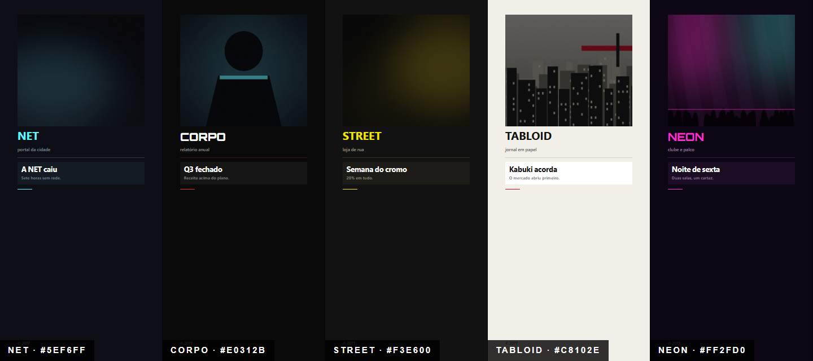
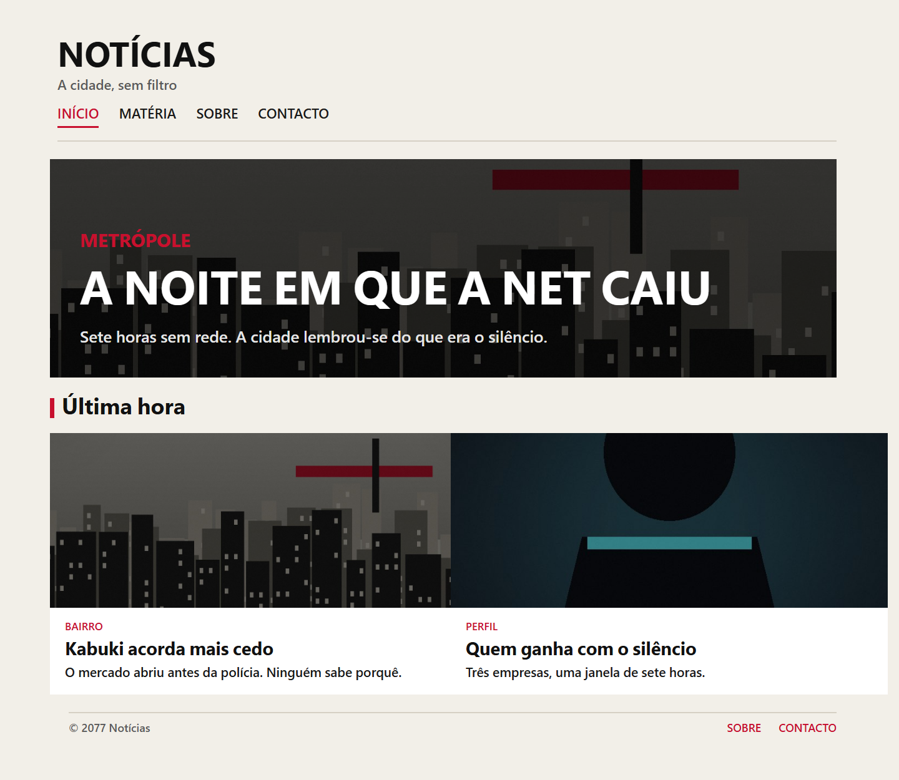
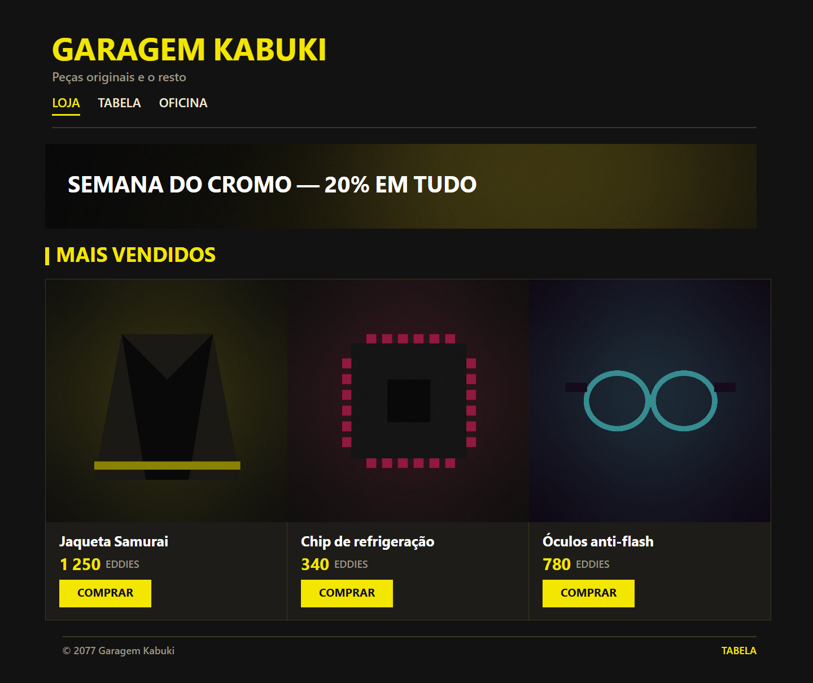
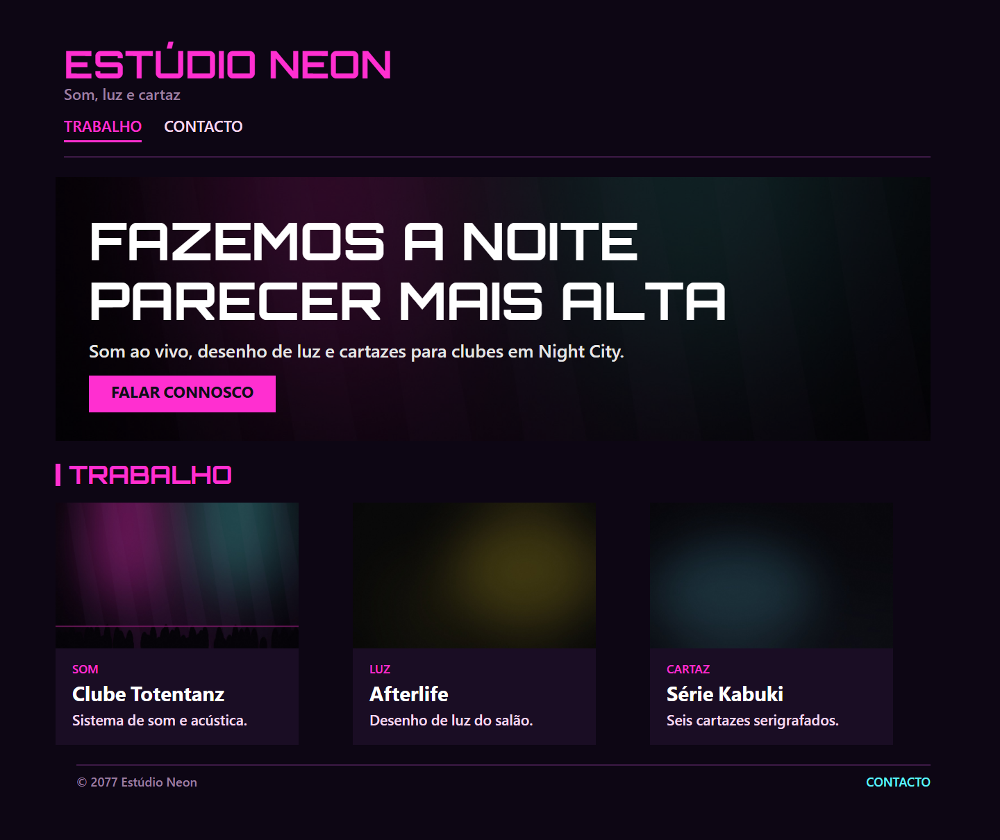
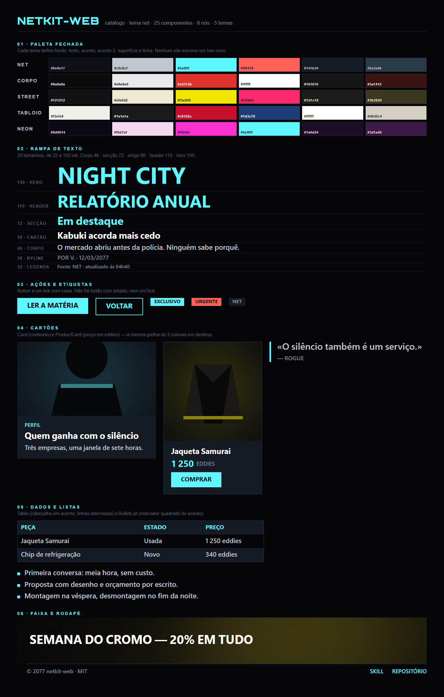
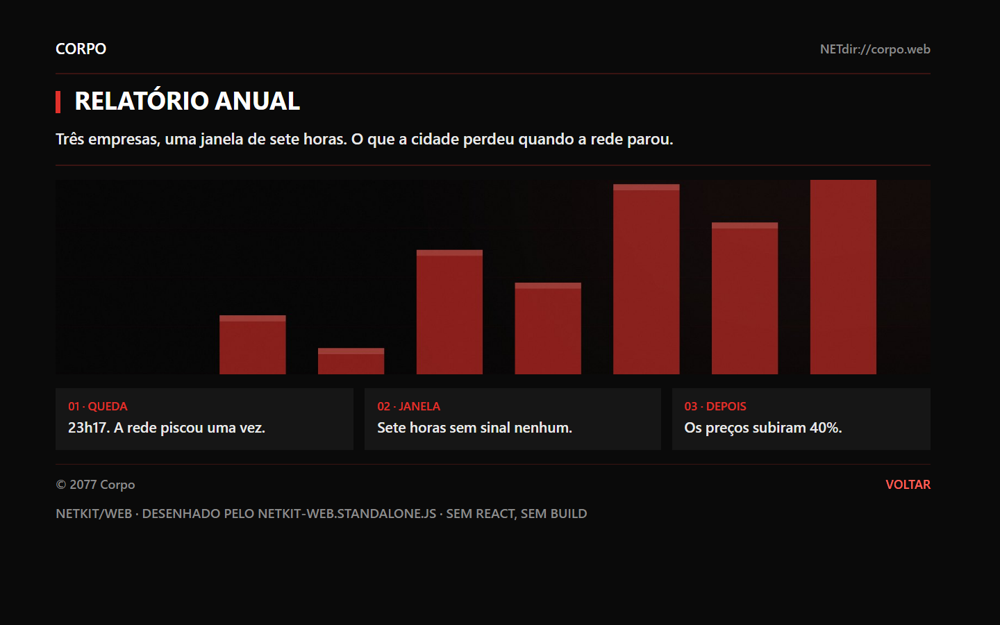

# NETKIT/WEB — sites no padrão do mod NetSites

[](LICENSE)
[](CHANGELOG.md)
[](#testes)
[](package.json)
[](CONTRIBUTING.md)
[](#instalar-como-skill-global)

O kit de frontend dos sites no padrão visual do **NetSites** (o navegador dos computadores do Cyberpunk 2077):
um sistema visual **fechado** — 5 temas, 8 nós de layout, 25 componentes React, rampas de tamanho, espaço e
cor — mais um renderer standalone que desenha `netsites-site/1` no browser sem React nem build.

Serve para duas coisas:

1. **entregar sites de verdade** (landing, notícia, loja, portfólio) com o visual da NET, sem ninguém poder
   «inventar» um botão novo;
2. **trazer para a web** um site escrito no formato do jogo/mod, com um `<script>` e um JSON.

Não é afiliado à CD Projekt Red. Não inclui — nem pode incluir — assets do jogo.

## Porque é fechado

Um sistema visual só é um sistema se não tiver exceções. Aqui, cor, tipo, espaço, forma e interação vivem
num único ficheiro ([`assets/netkit-web/netkit-web.css`](assets/netkit-web/netkit-web.css)) e os sites só
usam componentes. O `check` recusa HTML, `style=`, cores fora da paleta, tamanhos fora da rampa e props
inventadas; o `verify` recusa um kit alterado (sha256). Resultado: dez sites diferentes parecem o mesmo
produto — que é o objetivo.

## Arranque rápido

```bash
git clone https://github.com/frederico-kluser/cyberpunk-2077-sites-kit-agent-skill.git
cd cyberpunk-2077-sites-kit-agent-skill

python3 scripts/netkit.py verify                       # kit íntegro?
python3 scripts/netkit.py inject --target ~/meu-site --flavor react --name Noticias --new-site
python3 scripts/netkit.py check ~/meu-site/src/sites    # contrato visual
```

O starter gerado já passa no `check`: copie-o e troque o conteúdo.

### Sem React (site estático)

```bash
python3 scripts/netkit.py inject --target ~/site --flavor static --name Estatico
python3 scripts/netkit.py preview ~/site/netkit/site.json
```

```html
<link rel="stylesheet" href="netkit/netkit-web.css" />
<netsites src="netkit/site.json"></netsites>
<script src="netkit/netkit-web.standalone.js" defer></script>
```


## Prints

Capturas reais, geradas com browser headless a partir das páginas de `docs/prints/src/` — nenhuma foi
desenhada à mão e nenhuma usa conteúdo da CDPR.

[](docs/prints/01-temas.png)

[](docs/prints/02-noticia-tabloid.png)

[](docs/prints/03-loja-street.png)

[](docs/prints/04-portfolio-neon.png)

[](docs/prints/05-componentes.png)

[](docs/prints/06-noticia-mobile.png)

[](docs/prints/07-standalone-json.png)

```bash
npm run prints          # refaz as capturas (Chrome/Edge headless)
npm run prints:check    # confere que todas existem
```

Detalhe de cada imagem, arte e licenças das fontes: [`docs/prints/README.md`](docs/prints/README.md).

## O que existe

| | |
| --- | --- |
| **Temas** | `net` (ciano · `#0e0e17`) · `corpo` (vermelho/preto) · `street` (amarelo) · `tabloid` (papel claro) · `neon` (rosa/ciano) |
| **Nós** | `page` `column` `row` `stack` `text` `image` `rect` `spacer` |
| **Componentes** | `Site` `Page` `Column` `Row` `Stack` `Text` `Image` `Rect` `Spacer` · `NavBar` `Header` `Hero` `Button` `Card` `Grid` `Section` `Article` `ProductCard` `Divider` `Badge` `Quote` `BulletList` `Table` `Banner` `Footer` |
| **Tamanhos de texto** | 20 valores, de 32 a 150 ink (corpo = 46) |
| **Espaços** | 36 valores, de 0 a 240 ink |
| **Letras** | Rajdhani, Orbitron, Blender Pro, Industry, Arial · pesos 300–900 |
| **Forma** | raio 0 · sem sombras · sem gradientes · bordas 3 ou 4 · hover só por cor |

Tudo em **unidades ink** do jogo: 1 ink = `--nk-u` px (0,5 no desktop, menos em ecrãs estreitos). O kit
trata do responsivo sozinho — o site não escreve media queries.

## CLI

| Comando | O que faz |
| --- | --- |
| `inject` | copia o kit para o site + manifesto sha256 + página de arranque (`--flavor react\|static`) |
| `check` | valida o contrato visual de ficheiros `.jsx`, `.tsx`, `.html` e `.json` (`--json` para CI) |
| `verify` | confere o kit do repositório ou uma cópia instalada (`--target`) |
| `preview` | serve um `site.json` localmente, sem internet nem build |
| `new` | cria uma página React ou um `site.json` |
| `list` | imprime o inventário fechado (componentes, temas, rampas, cores) |
| `build` | sincroniza a CSS embutida no standalone |
| `version` | versão do kit |

Saída `0` ok · `1` problemas · `2` uso inválido · `3` kit incompleto. Erros sempre
`Erro: <o quê> — Solução: <o que fazer>`.

## Instalar como skill global

A skill é este repositório (`SKILL.md` na raiz). Para a ligar a todos os agentes da máquina:

```bash
bash scripts/link-skill-global.sh            # cria os symlinks
bash scripts/link-skill-global.sh --check    # 0 = tudo conforme
```

Liga em `~/.dsh/skills`, `~/.claude/skills`, `~/.agents/skills`, `~/.codex/skills`, contas `~/.claude-*`,
`~/.jcode/skills`, `~/.pi/agent/skills` e `~/.config/opencode/skill` — os mesmos locais das outras skills.
Nunca substitui um diretório real: move-o para `~/Agent-Skills/.link-backups/`.

## Estrutura

```
SKILL.md                      o contrato que o agente carrega
assets/netkit-web/            netkit-web.js · .css · .d.ts
assets/standalone/            netkit-web.standalone.js (CSS embutida)
scripts/netkit.py             a CLI
scripts/link-skill-global.sh  registo global por symlink
references/                   design-system · componentes · formato-site · proibido · injecao · exemplos · checklist
tests/                        48 testes (15 node + 33 python), sem dependências
docs/prints/                  capturas reais + gerador (scripts/prints.py)
```

## Testes

```bash
npm test          # node --test (14) + python -m unittest (30)
npm run verify    # CSS embutida == origem, versões, exports
```

Sem `npm install`: não há dependências. O CI corre os dois em cada PR e no `main`.

## Contribuir

Commits convencionais, branch `<tipo>/<slug>`, PR com squash. O contrato completo está em
[`CONTRIBUTING.md`](CONTRIBUTING.md) e os gates em [`AGENTS.md`](AGENTS.md). Ideias de evolução do kit
(um componente novo, um tema) são bem-vindas — **depois** de o sistema e os testes acompanharem.

## Licença

MIT — ver [`LICENSE`](LICENSE). Cyberpunk 2077 e Night City são marcas da CD Projekt Red; este projeto é
independente e não distribui conteúdo do jogo.
